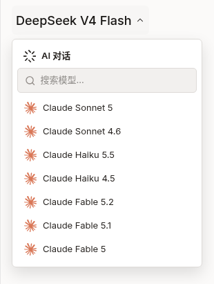
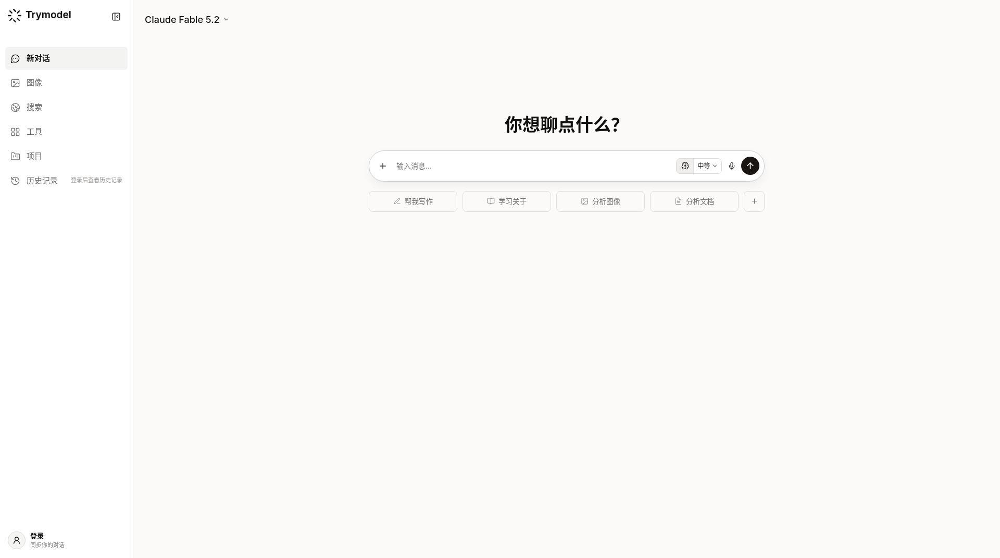

# Claude Fable 5.2 已在 Trymodel 上架

这次在 Trymodel 的模型列表里，已经能看到 Claude Fable 5.2 了。站点是 https://trymodel.chat/ ，展示名就是 Claude Fable 5.2，模型 id 是 `claude-fable-5-2`。

打开列表可以对上位置：它排在 Fable 5.1 上面，再下面是 Fable 5。截图时未登录也能看到并选中这支模型。

站内聊天的计费方式，不是按百万 token 对外公示的价目表，这里不写价格。

## 怎么找到它

1. 打开 https://trymodel.chat/ 。
2. 在模型列表里找到展示名为 Claude Fable 5.2 的一项，它在 Fable 5.1 上方。
3. 选中后，即可在站内聊天界面里使用。

## 渠道汇总

下面是 https://claude-opus.top/ 当前列出的使用渠道，按该页写法整理。额度、模型和能否使用，请以各站实时说明为准。

### 推荐入口：Trymodel

- 地址：https://trymodel.chat/
- 该页把它标为官方推荐入口，并写明：Pro 日额度 40 次 + 20 万 Token；免费登录日请求为 0，Claude 需 Pro；DeepSeek V4 Flash 始终不限日额度。
- 该页列出的 Claude 线是：Opus 5.5 / 5 / 4.8 / 4.7 / 4.6 / 4.5，Sonnet 5.5 / 5 / 4.6，Haiku 5.5 / 4.5，Fable 5.1 / 5。我们今天在 Trymodel 列表里还看到了 Claude Fable 5.2，排在 5.1 上面。

### 国内渠道

- https://tryallapi.com/（该页标注为「国内渠道」「官方店铺」）

### 原镜像商城

- https://momoai.czvip.cn/products/m10

### Claude Desktop 桌面客户端

- 购买：https://momoai.asia
- 教程：https://github.com/xianyu110/claude.asia/blob/main/CLAUDE_DESKTOP.md
- 该页说明：支持客户端直连、提供 CC Switch 配置工具、2000 美刀额度标准月卡、国内直连。

### 备选：普号 + Session Key 登录 funclaude

该页写明这是补充路径，主入口仍是 trymodel.chat。

- 购买 Claude Mail 邮箱普号：https://chongzhi.chatgpt-plus.top/claude/（该页写约 ¥15）
- 登录：https://fun.hugai.top/login
- 图文教程：https://maynor996.github.io/claude-sessionkey-funclaude-guide-2026/
- 教程仓库：https://github.com/Maynor996/claude-sessionkey-funclaude-guide-2026

该页同时提醒：风险自负，不保证长期不封号；Session Key 不要分享；封号售后通常不做。升级 Pro（该页写约 ¥199/月）同样不保证不封号。

该页的联系方式是微信 `claude-support`，QQ `1002569303`。
